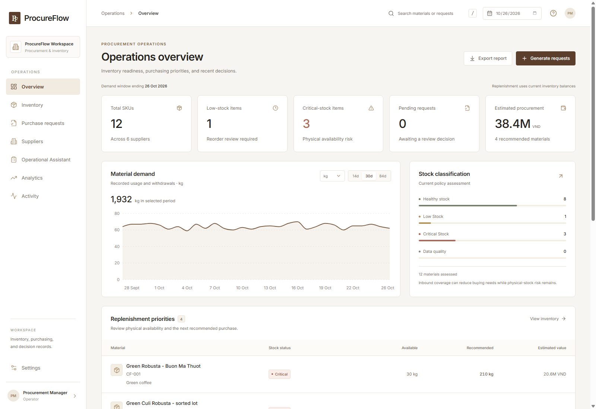
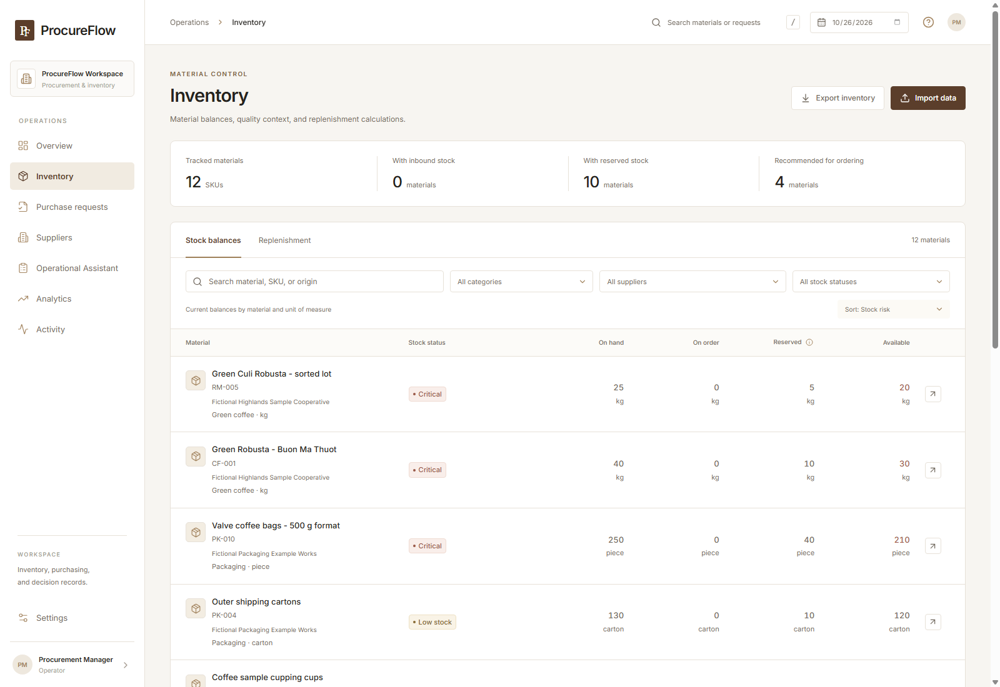
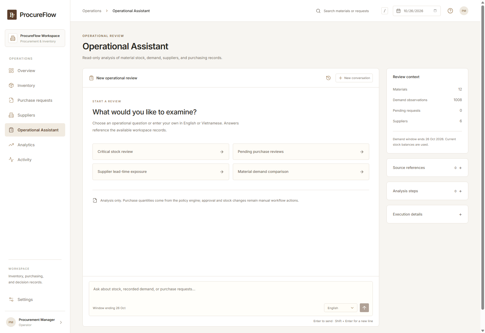
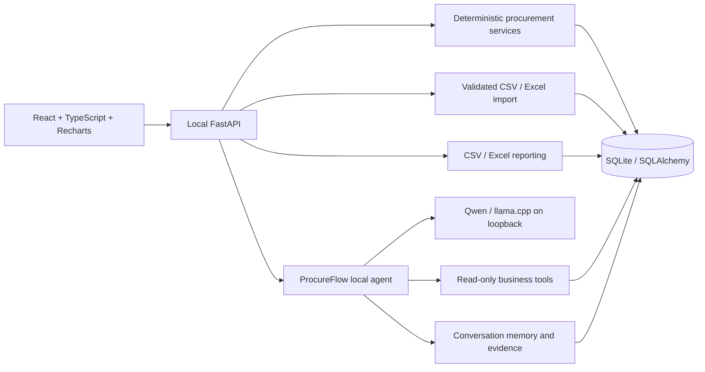

# ProcureFlow

A coffee procurement and inventory workspace with a premium React interface, persistent Python workflows, and a local operational assistant.

Inventory, purchasing, suppliers, analytics, and operational history live in one application. The assistant retrieves workspace facts with source references and uses Qwen locally for intent planning. No cloud inference, API key, or paid AI subscription is required.

Academic case study using synthetic data. Not affiliated with or endorsed by Trung Nguyen Legend or Bosch. Internal approvals do not send supplier orders or payments.

## Interface







The interface includes eight pages: Overview, Inventory, Purchase requests, Suppliers, Operational Assistant, Analytics, Activity, and Settings. Warm ivory, charcoal, espresso accents, local Inter fonts, consistent spacing, searchable tables, and restrained charts form a single design system.

- **Overview:** compact operational metrics, demand history, stock classification, replenishment priorities, and recent changes.
- **Inventory:** category/risk filters, sorting, stock/replenishment views, material metadata, historical demand, editable balances, and CSV/Excel imports.
- **Purchase requests:** draft generation, duplicate prevention, saved quantities/costs, required review reasons, approval/rejection.
- **Suppliers:** directory, associated products, contact details, reference lead times, contextual imports.
- **Operational Assistant:** English/Vietnamese conversations, short-query support, persistent context, expandable evidence, and discreet technical details.
- **Analytics:** demand and recorded stock trends, supplier lead times, request status, Excel/CSV reports.
- **Activity:** searchable events, approval history, exceptions, and before/after evidence.
- **Settings:** persistent operator/workspace preferences and local engine information.

## Run on this machine

Dependencies, the frontend build, llama.cpp, and the local Qwen model have been installed in this workspace.

Double-click **run-coffee.bat** to open the separate synthetic coffee scenario, or execute:

```powershell
.\.venv\Scripts\python.exe -m scripts.run --coffee
```

Open **http://127.0.0.1:8002** for the separate coffee workspace. Normal startup without `--coffee` retains port 8000 and the existing configured database. Pass `--port` to choose another port. The launcher starts the available local model and web application. No Node development server is required after building. Stop the terminal with Ctrl+C to stop the launcher and any model process it started.

The `--coffee` option selects `outputs/coffee-workspace.db`; it never replaces `procureflow.db`. Without that option, `run.bat` and `python -m scripts.run` keep the existing workspace. Existing user records are not relabeled as coffee materials.

The former Streamlit interface remains available as a compatibility UI; the React workspace above is the primary application.

## Fresh setup — Windows

Requires Windows x64, Python 3.11+, and Node.js 20.19+ or 22.12+; the local verification used Python 3.13.6 and Node 24.13.0. Internet access is needed for dependency/model installation, not for subsequent local use.

```powershell
python -m venv .venv
.\.venv\Scripts\python.exe -m pip install -r requirements-dev.txt
Set-Location frontend
npm.cmd ci
npm.cmd run build
Set-Location ..
.\.venv\Scripts\python.exe -m scripts.setup_local_ai
.\.venv\Scripts\python.exe -m scripts.run --coffee
```

If the Windows `python` command points to MSYS or an older interpreter, use the path to a Windows Python 3.11+ installation when creating the environment. On the verified machine:

```powershell
& "$env:LOCALAPPDATA\Programs\Python\Python313\python.exe" -m venv .venv
```

The model installer downloads approximately 1.12 GB of Qwen2.5 1.5B Instruct Q4_K_M weights plus the official llama.cpp CPU runtime, checks SHA-256 hashes, and retains third-party license information. Files stay in ignored `models/` and `runtime/` directories. Startup never downloads a model implicitly.

To run all business features and the local tool agent without loading a language model:

```powershell
.\.venv\Scripts\python.exe -m scripts.run --coffee --without-model
```

## Your local agent

ProcureFlow implements the orchestration, read-only business tools, numerical grounding, conversation memory, and evidence display. **Qwen is a third-party pretrained model**, not a foundation model trained by this project.

The local model returns a validated intent/SKU/language plan. Python retrieves inventory, demand, supplier, request, and audit facts and renders the numerical answer. The model does not execute SQL or choose purchase quantities. Each response shows which tools and records were used.

Try:

- “Why reorder CF-001?”
- “Tại sao cần mua CF-001?”
- “Chi phí bao nhiêu?” as a follow-up.
- “Giá”, “Bao nhiêu tiền?”, or “Chi phí?” for the selected material's price.
- “Còn hàng không?”, “Tại sao phải nhập thêm?”, or “Nhà cung cấp nào?” as follow-ups.
- “Show stock risk for all SKUs.”
- “Những đề xuất nào đang chờ phê duyệt?”
- “Show demand trends for RM-005.”

A response shows `local_model` only when a valid model plan was actually used. If the runtime is unavailable, slow, or returns an invalid plan, the same business tools answer in `local_tools` mode. This distinction is visible in the UI; it is not disguised as model inference.

Inference accepts only loopback addresses, ignores environment proxies, and refuses redirects. No business records leave the machine. Agent writes are limited to its own conversation tables; procurement changes use the normal review screens.

See [local agent implementation and configuration](docs/LOCAL_AGENT.md) and [third-party notices](THIRD_PARTY_NOTICES.md).

## Configuration

Optional `.env` settings:

```dotenv
PROCUREFLOW_DB_PATH=procureflow.db
LOCAL_LLM_ENABLED=true
LOCAL_LLM_URL=http://127.0.0.1:8089
LOCAL_LLM_MODEL=qwen2.5-1.5b-instruct
LOCAL_LLM_TIMEOUT_SECONDS=30
```

The bundled launcher manages the default local runtime at port 8089. For an independently managed local llama.cpp server, configure its loopback URL and start the web API directly. Restart after configuration changes.

For frontend development, use two terminals:

```powershell
.\.venv\Scripts\python.exe -m uvicorn src.api:app --host 127.0.0.1 --port 8000
```

```powershell
Set-Location frontend
npm.cmd run dev
```

Vite serves port 5173 and proxies API calls to the local Python service.

## Architecture



The application retains the tested starter's storage, policy, import, and reporting services. A new FastAPI layer exposes them to React. The primary frontend is in `frontend/src/`; it does not duplicate inventory calculations.

Database tables include products, suppliers, inventory, sales, proposals, approval history, audit logs, exceptions, inventory snapshots, app settings, agent conversations, and agent messages. Spreadsheet reports contain the nine business tables plus a dated inventory assessment; chat history is not silently mixed into operational reports.

See [architecture and ERD](docs/ARCHITECTURE.md).

## Inventory policy and workflow

```text
daily demand = units in the last 14 calendar days / 14
inventory position = on hand + on order - reserved
reorder point = ceil(daily demand * lead time + safety stock)
target stock = ceil(daily demand * (lead time + 4 review days) + safety stock)
order quantity = positive gap to target, rounded up to a complete pack
```

An order is recommended only with positive demand, position at/below the reorder point, and a positive target gap. Integer arithmetic implements ceiling operations without floating-point unit-boundary errors.

Risk categories are Healthy, Low stock, Critical, and Needs data in the interface. Physical-stock risk remains visible even when inbound stock prevents another purchase recommendation. Missing supplier/history blocks automatic drafts.

Generate creates saved drafts and skips SKUs with draft or approved requests. Approval requires a reviewer and reason, rechecks the saved inputs, increments on-order once, and records history. Changed inputs make a draft stale; it can be rejected and regenerated. No supplier purchase order is transmitted.

Requests retain their original unit/category along with cost and supplier. A material's base unit cannot change after stock or recorded history exists; the system does not reinterpret kg as cartons or silently convert historical quantities.

The analysis date selects the demand window; calculations use **current inventory balances**. Demand comparisons are descriptive history, not forecasts. Audit timestamps are UTC and the business date uses Vietnam time.

## Imports and reports

Import CSV or a single-sheet `.xlsx` through the modal. Files are limited to 2 MB and 10,000 data rows.

| Dataset | Required columns | Optional |
|---|---|---|
| Suppliers | `name` | `lead_time_days,contact_email` |
| Products | `sku,product_name,supplier,lead_time_days,safety_stock,pack_size,unit_cost_vnd` | `on_hand,on_order,reserved_qty` |
| Inventory | `sku,on_hand,on_order` | `reserved_qty` (defaults to zero) |
| Sales | `sale_date,sku,units` | None |

Import suppliers before products, then inventory/sales. SKUs use 1–64 letters, digits, dots, underscores, or hyphens, beginning with a letter/digit. Dates use `YYYY-MM-DD`. Invalid references, duplicate keys/headers, negative/fractional quantities, future dates, and conflicting sales reject the whole file.

Identical imports are no-ops. Changed masters and balances retain audit evidence. Approved inbound quantities are protected. Reports preserve numeric cells and escape formula-looking text. Excel/CSV tables can be imported into Power BI; a `.pbix` dashboard is not included.

## Data and repeatable scenario

The new `data/coffee/` scenario contains 12 green-coffee, roasted-input, packaging, and accessory materials from six explicitly fictional suppliers. It preserves identifiers such as `CF-001` in its own separate database. Its `sales` rows are synthetic material withdrawals, not real company transactions. Quantities are whole base units; mixed physical units are never summed into a single chart/KPI total.

Create another clean coffee workspace explicitly:

```powershell
.\.venv\Scripts\python.exe -m scripts.seed_coffee --db outputs/coffee-interview-02.db --as-of 2026-10-26
$env:PROCUREFLOW_DB_PATH="outputs/coffee-interview-02.db"
.\.venv\Scripts\python.exe -m scripts.run
```

The seeder refuses every existing target file. Do not import these scenario files over an existing business workspace. Source-backed material terminology and clearly identified assumptions are documented in [RESEARCH_SOURCES.md](docs/RESEARCH_SOURCES.md).

The retained original workspace starts with six synthetic SKUs, three suppliers, and 84 days of generated demand/stock history. Existing populated databases are preserved. To create another original six-SKU fixed-date database:

```powershell
.\.venv\Scripts\python.exe -m src.seed --db interview-02.db --as-of 2026-10-26
$env:PROCUREFLOW_DB_PATH="interview-02.db"
.\.venv\Scripts\python.exe -m scripts.run
```

For repeatable import → shortage → draft → approval/rejection → reports:

```powershell
.\.venv\Scripts\python.exe -m scripts.demo --as-of 2026-10-26
```

Each run creates a separate `outputs/demo/run_*/` directory with SQLite database, inputs, Excel/CSV reports, offline briefing, and verification manifest. Rebuild input examples with `python -m scripts.export_samples`.

See [walkthrough](docs/DEMO_SCRIPT.md).

## Verification

```powershell
$testTemp = Join-Path ([IO.Path]::GetTempPath()) ("ProcureFlow_QA_" + [guid]::NewGuid().ToString('N'))
New-Item -ItemType Directory -Path $testTemp -Force | Out-Null
.\.venv\Scripts\python.exe -m pytest -q --basetemp=$testTemp -p no:cacheprovider
.\.venv\Scripts\python.exe -m pip check
Set-Location frontend
npm.cmd run build
```

Tests cover policy arithmetic, imports, concurrent duplicate prevention, stale reviews, persistence, reports, API routes, local-agent plans and conversation context, cloud-call exclusion, and the retained Streamlit compatibility UI. They use temporary databases and mocked inference.

Actual local model inference and real React browser workflows were also checked separately. See [executed verification](docs/VERIFICATION.md). No coverage percentage or business improvement has been claimed.

## Research and visual identity

Official company pages support Robusta/Arabica/Culi terminology, selected origin examples, and the historical white/black identity direction. All supplier identities, quantities, costs, leads, and commercial records in the coffee scenario are synthetic assumptions. See [research evidence](docs/RESEARCH_SOURCES.md).

No authorization to bundle an official company logo was established. The default wordmark is neutral ProcureFlow; a documented [authorized local asset slot](frontend/public/brand/README.md) preserves image proportions if permission is later supplied. The interface retains an accessible academic/non-affiliation notice. Design tokens, contrast, charts, and interaction rules are documented in [DESIGN_SYSTEM.md](docs/DESIGN_SYSTEM.md).

GitHub Actions is configured for Python tests on Windows/Linux with Python 3.11/3.13, plus a frontend build. Remote runs remain unverified until the repository is pushed.

## Operational boundaries

- Local application; operator names are entered manually and are not authenticated accounts.
- No ERP, supplier messaging, payment, invoice, or external purchasing integration.
- Approved requests remain outstanding; goods receipt/cancellation/closure are future work.
- SQLite safeguards were tested locally, not under enterprise load.
- Append-only triggers protect ordinary history changes; a database administrator can bypass them.
- Synthetic inventory history models depletion without receipts. No actual company performance is measured.
- Local language model quality is limited; exact facts and permissions stay under application control.

## GitHub

MIT licensed project code. Keep `.env`, databases, `outputs/`, model weights, runtime binaries, `.venv/`, and `node_modules/` out of Git. The lockfile is included; the frontend build is generated locally or by CI.

After creating an empty GitHub repository, review files and publish:

```powershell
git init
git add .
git status --short
git diff --cached --stat
git commit -m "Build ProcureFlow local AI procurement workspace"
git branch -M main
git remote add origin https://github.com/YOUR_USERNAME/procureflow-ai.git
git push -u origin main
```

No remote publication is performed automatically.

