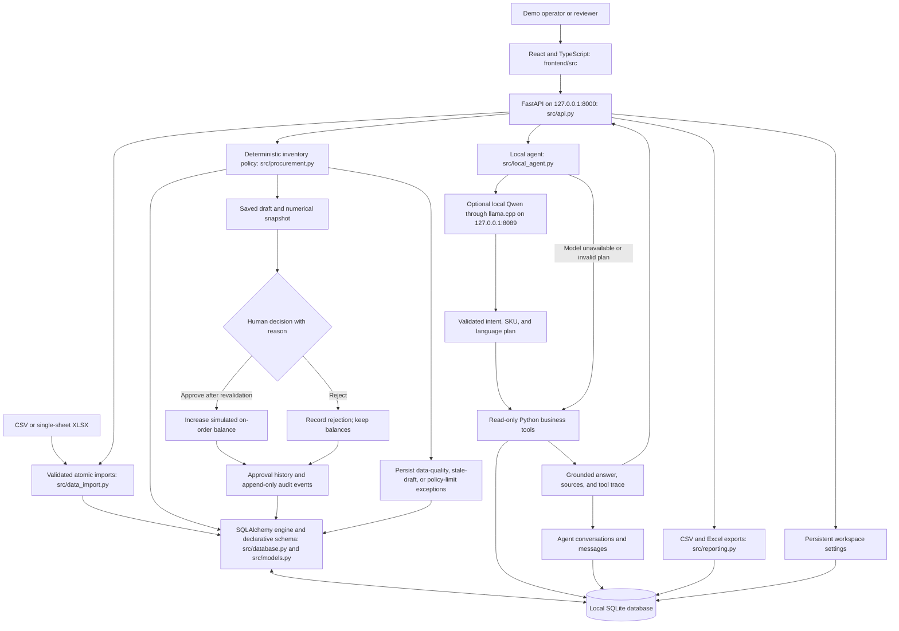
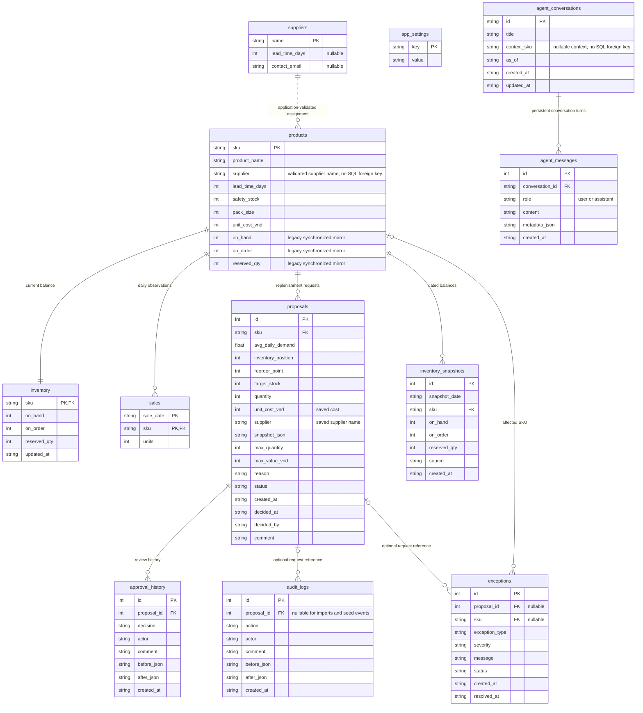

# Architecture and data contracts

ProcureFlow AI is a local academic prototype using synthetic data. It is not affiliated with or endorsed by Trung Nguyen Legend. The application records internal replenishment reviews; it never sends supplier orders or payments.

## Components and data flow



`scripts/run.py` starts the primary application and the installed optional local model; `run.bat` is the Windows shortcut. FastAPI serves the built `frontend/dist` assets and JSON endpoints on the same local origin. React provides eight pages: Overview, Inventory, Purchase requests, Suppliers, AI workspace, Analytics, Activity, and Settings. Hash navigation uses paths such as `/#inventory` and `/#ai`. Local Inter font files, Lucide icons, and Recharts supply the visual system without external font requests. During development, Vite on port 5173 proxies API calls to port 8000.

`src/api.py` handles validated HTTP contracts, persistent preferences, and application startup. `src/procurement.py` owns arithmetic, draft creation, exceptions, and decisions. `src/data_import.py` validates whole files before committing changes. `src/local_agent.py` orchestrates local intent planning and read-only business tools; its only writes are conversation records. `src/reporting.py` produces spreadsheet-safe exports. `src/ai_assistant.py` retains the starter's offline summary interface without a cloud adapter. The optional Streamlit compatibility interface remains in `app.py` and `src/ui.py`. `scripts/demo.py` independently replays the business workflow into a new persistent output folder.

SQLAlchemy manages the SQLite engine, connection pool, and declarative business-table definitions. The storage adapter exposes SQLite DB-API cursors and rows so the business layer can use parameterized SQL and explicit transactions. The application does not claim that every query uses an ORM session. FastAPI migrates and seeds once during startup, then opens and closes a connection per request. Workspace/report reads use consistent read transactions; business mutations use the existing serialized service transactions. API mutations reject browser origins outside the configured local app origins. Manual operator names remain demo metadata, not authentication.

## Persistent data model

The primary application database contains twelve tables: nine business tables plus preferences and two agent-memory tables. A business-only CLI replay creates the nine business tables. JSON fields preserve decision evidence and conversation metadata.



`inventory` represents current stock. The three balance fields in `products` remain as a compatibility mirror for the starter's policy queries. Database triggers synchronize changes between the two tables, and tests verify both update directions. Supplier assignments are validated by the import and policy layers; the product supplier text has no database foreign key so missing legacy assignments can be surfaced as data-quality exceptions. The product's `lead_time_days` is the policy input; the optional supplier-level value is reference data.

`inventory_snapshots` is unique on `(snapshot_date, sku, source)`. Analytics selects the latest recorded snapshot for each SKU/day. The seed generates 84 days of sales and explicitly labeled `synthetic_seed` inventory balances in a consistent no-receipts depletion scenario. Those balances are synthetic, not measured business history. Imports and approvals record actual state within the simulation under their own sources; charts do not invent unrecorded dates or receipts.

`app_settings` stores `operator_name` and `workspace_name`; changes append audit evidence. Agent conversations retain SKU/date context. Each user and assistant turn is saved in `agent_messages`; assistant metadata records the actual mode, model, intent, tools, sources, and suggested follow-ups. The model does not receive a database connection or a write tool. Agent chat does not modify products, inventory, sales, requests, or business audit history.

## Deterministic inventory policy

The lookback covers 14 calendar days including the analysis date; the review period is four days. Missing calendar dates contribute zero units to the average. Observation counts remain visible, and a SKU with no sales observations at all is a data-quality issue rather than evidence of confirmed zero demand.

```text
daily_demand       = units_in_last_14_calendar_days / 14
available_stock    = on_hand - reserved_qty
inventory_position = on_hand + on_order - reserved_qty
reorder_point      = ceil(daily_demand * lead_time_days + safety_stock)
target_stock       = ceil(daily_demand * (lead_time_days + 4) + safety_stock)
gap                = max(0, target_stock - inventory_position)

if demand > 0 and inventory_position <= reorder_point and gap > 0:
    quantity = ceil(gap / pack_size) * pack_size
else:
    quantity = 0

estimated_cost_vnd = quantity * unit_cost_vnd
```

The implementation computes ceilings with integer arithmetic using total units and the window length. It does not use rounded displayed demand to calculate a quantity, so exact unit boundaries avoid floating-point rounding errors. A recommendation is a rule-based replenishment estimate, not a machine-learning demand forecast.

| Risk category | Rule |
|---|---|
| Data Quality Issue | No sales observations in the window, or a missing/unknown supplier. Automatic quantity is zero. |
| Critical Stock | Positive demand and available stock is at/below safety stock or below demand during lead time. |
| Low Stock | Reordering is required and the physical-stock critical condition is false. |
| Normal | Neither critical physical stock nor an active reorder condition applies. |

Critical physical risk is independent of inbound coverage. An approved request can reduce the recommended purchase quantity to zero while the item remains critical until goods actually arrive. The prototype has no receipt lifecycle.

For example, demand of 10/day, lead time of five days, safety stock of 20, on-hand of 55, reserved stock of five, on-order of zero, and pack size of 20 produces a position of 50, reorder point of 70, target of 110, and order quantity of 60. The current 14-day sales total is also compared with the previous 14-day total; the percentage is unavailable when the previous total is zero. This is descriptive history, not a forecast.

The selected analysis date changes the demand window. **Replenishment always uses current inventory balances**, even when that date is historical; it does not reconstruct a historical purchasing decision. Exported assessments include `assessment_date`. Audit timestamps are UTC; the application's business date uses UTC+7 for Vietnam.

## Import contracts

All four datasets accept UTF-8 CSV or one-worksheet `.xlsx`, up to 2,000,000 bytes and 10,000 data rows. Headers must be unique; unexpected columns, missing required fields, invalid dates, unknown references, duplicate keys, and invalid quantities are rejected. SKUs contain 1–64 ASCII letters, digits, dots, underscores, or hyphens and start with a letter or digit. Quantities and costs are whole non-negative numbers bounded by validation; lead time and pack size are at least one.

| Dataset | Required columns | Optional columns and behavior |
|---|---|---|
| Suppliers | `name` | `lead_time_days`, `contact_email` |
| Products | `sku,product_name,supplier,lead_time_days,safety_stock,pack_size,unit_cost_vnd` | `on_hand,on_order,reserved_qty`; omitted balances are preserved on existing products and start at zero on new products. |
| Inventory | `sku,on_hand,on_order` | `reserved_qty`; defaults to zero when omitted. The application records a snapshot at the selected analysis date. |
| Sales | `sale_date,sku,units` | None. Dates use `YYYY-MM-DD` and cannot exceed the import's analysis date. |

Import suppliers before products, and products before inventory or sales. Master data and inventory are upserts. Sales history is append-only: identical stored date/SKU values are skipped, while conflicting values reject the entire file. Files validate before writes, and a transaction rolls back earlier rows if a later reference or stored-data conflict fails. Changed imports include before/after evidence in an audit event. Import cannot erase an outstanding approved quantity by changing that SKU's `on_order`.

## Workflow and control points

1. `create_drafts` obtains a `BEGIN IMMEDIATE` write transaction before checking and inserting requests. It skips SKUs with a `DRAFT` or `APPROVED` request, records data-quality/policy-limit exceptions, and stores the exact numerical assessment, supplier, cost, and limits on each new draft.
2. New or clean databases also enforce one `DRAFT` per SKU with a partial unique index. If an old database already contains duplicate drafts, migration preserves them and records a visible `LEGACY_DUPLICATE_DRAFT` exception; the index is deferred until that conflict is resolved.
3. Approval and rejection require a reviewer name and a non-empty reason. Decisions serialize in a transaction. A processed request cannot be reviewed again.
4. Approval recalculates the saved assessment date against current balances and policy inputs. Changed stock, demand, supplier, cost, or policy makes the draft stale and blocks approval. The exception is retained; the reviewer can reject the stale request and generate a fresh one.
5. Approval changes `on_order` once, records a balance snapshot, and appends approval/audit evidence. Rejection records its decision without changing stock. Saved costs preserve request value if the product price later changes.
6. Audit and approval-history triggers reject ordinary SQL updates and deletes. This is application-level traceability, not tamper-proof storage: a database administrator can alter the file or schema.

Default simulated limits are 100,000 units and 100,000,000 VND per draft. They are policy guardrails, not a real company's approval thresholds.

## Local agent boundary

The optional model is **Qwen2.5-1.5B-Instruct Q4_K_M**, a third-party pretrained model served by a local llama.cpp CPU runtime. The installed reference runtime is b11889 and the GGUF is 1,117,320,736 bytes; setup verifies SHA-256 hashes and keeps a local manifest and third-party notices. `scripts.setup_local_ai` is the explicit download step. Application startup never downloads software or weights.

The model returns only a constrained intent/SKU/language plan validated by Pydantic. Python selects read-only tools for inventory, replenishment reasons, risk, demand, budget, suppliers, requests, policy, or audit facts. Clear rule routes guard against model misclassification. Numerical answers are rendered from database records and the deterministic policy; generated SQL and model-calculated purchasing quantities are never executed. Action requests such as approving or buying are refused and directed to the review workflow.

Chat supports English and Vietnamese, saved conversation history, SKU/date follow-ups, visible source references, and tool traces. `local_model` is shown only when a valid model plan was used. Missing runtime, timeout, invalid configuration, malformed output, or an inconsistent plan uses the same Python tools in `local_tools` mode. Setting `LOCAL_LLM_ENABLED=false` or launching with `--without-model` guarantees tool-only operation.

Inference endpoints must be loopback IPs or localhost; environment proxies and redirects are disabled. Default inference is `http://127.0.0.1:8089`. There are no Gemini or other cloud inference calls, API keys, or paid-service dependencies. Model inference and chat persistence are separate from procurement permission and numerical authority. A local model remains fallible; the application exposes its mode and sources instead of treating its prose as evidence.

See [LOCAL_AGENT.md](LOCAL_AGENT.md) for configuration and implementation details, and [VERIFICATION.md](VERIFICATION.md) for executed local model checks. Qwen's weights and llama.cpp are third-party components, not models trained by this project.

## API and reporting

FastAPI exposes workspace/settings reads, draft generation, request decisions, inventory editing, multipart CSV/XLSX import, template downloads, workbook/CSV exports, agent status, chat, and conversation history under `/api`. Dates are strict `YYYY-MM-DD`; quantities, actor fields, and comments are bounded and validated. Invalid operations return JSON errors. Unknown API routes never fall through to the React page. Static assets and hash navigation are served from `frontend/dist` on port 8000; missing assets return explicit errors.

CSV and Excel reports contain the nine business tables plus a dated replenishment assessment: ten worksheets. Preferences and chat tables are excluded from operational reports. Request exports include saved supplier/cost values and their calculated request value. Spreadsheet-formula prefixes in text are escaped; numeric cells retain numeric values. Excel includes empty worksheets with schema headers. These are Power BI importable tables; there is no `.pbix` dashboard in this prototype.

## Deliberate limitations

- Reviewer/operator names are manually entered. There is no authentication, role enforcement, or separation of duties.
- Approved requests remain outstanding indefinitely. Receipt, delivery scheduling, cancellation, invoice, and payment lifecycles are not implemented.
- There is no ERP integration, supplier API, real purchase-order dispatch, or live company data.
- SQLite transactions and the tested two-connection safeguards do not establish high-load production suitability.
- Seed history, demand changes, and costs are synthetic; no operational improvement percentages or savings have been measured.
- Audit triggers do not defend against a database administrator. Backups, retention governance, and production security require additional work.
- A local model and successful local checks do not establish general model accuracy or enterprise deployment readiness. GitHub-hosted CI remains unverified until an actual remote run exists. See [VERIFICATION.md](VERIFICATION.md) for executed evidence.
