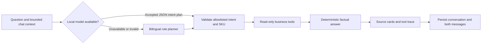

# ProcureFlow local agent

ProcureFlow's agent runs inside this project. It answers procurement questions by selecting read-only tools, retrieving the application's SQLite records, and returning an answer with tool traces and source cards. Conversations and their evidence are persisted locally.

The optional Qwen model runs through a local llama.cpp process. No cloud inference service or API key is used. The orchestration, business tools, grounding, conversation storage, and permission boundaries are implemented in this repository; Qwen is a third-party pretrained model, not a model trained by this project.

Model attribution and technical details are available in the [official Qwen2.5-1.5B-Instruct GGUF model card](https://huggingface.co/Qwen/Qwen2.5-1.5B-Instruct-GGUF). The downloaded license is retained as `models/QWEN-LICENSE.txt`; inference uses the [llama.cpp runtime](https://github.com/ggml-org/llama.cpp).

## Two honest execution modes

| Mode | Planning | Answers and numbers |
| --- | --- | --- |
| `local_model` | A running local model returns a validated intent plan | Python tools retrieve evidence and render business facts |
| `local_tools` | Bilingual rules select the tool plan | The same tools and factual renderers work without model files or a runtime |

An answer is marked `local_model` only when a valid inference result was accepted. A stopped server, timeout, malformed JSON, unsupported intent, unknown SKU, or inconsistent plan produces a useful `local_tools` answer. A healthy runtime does not by itself prove that a particular chat answer used inference: inspect that answer's `mode` and `local_model_planner` trace.

## Run locally on Windows

Install the project's requirements as described in the main README. To install the optional Windows CPU runtime and model:

```powershell
.\.venv\Scripts\python.exe -m scripts.setup_local_ai
```

The setup command downloads the official llama.cpp runtime and Qwen2.5 1.5B Instruct Q4_K_M GGUF weights and verifies checksums. Downloads require an internet connection; subsequent inference uses the local model. Runtime binaries and model weights remain in ignored `runtime/` and `models/` directories.

The application launcher starts the available local runtime with the web application:

```powershell
.\.venv\Scripts\python.exe -m scripts.run
```

For an existing local llama.cpp server, configure the application process:

```powershell
$env:LOCAL_LLM_ENABLED = "true"
$env:LOCAL_LLM_URL = "http://127.0.0.1:8089"
$env:LOCAL_LLM_MODEL = "qwen2.5-1.5b-instruct"
$env:LOCAL_LLM_TIMEOUT_SECONDS = "30"
```

To use the complete tool-based agent without any model process:

```powershell
$env:LOCAL_LLM_ENABLED = "false"
```

Model status performs a short health probe. Inference has a configurable timeout bounded to 1–60 seconds, with a short connection timeout. CPU speed and available memory affect inference latency. The default model endpoint is `http://127.0.0.1:8089`; an optional `/v1` suffix is accepted. The adapter currently supports llama.cpp's chat-completions protocol, not Ollama's native `/api/chat` protocol.

## Questions to demonstrate

| Question | Retrieved evidence |
| --- | --- |
| `Why reorder CF001?` / `Tại sao cần mua CF-001?` | Current stock, reservations, exact policy quantity, demand window, target stock, pack rounding |
| `What is its cost?` / `Chi phí bao nhiêu?` | Continues the previous SKU; current recommendation value and saved draft value |
| `Giá` / `gia` / `Bao nhiêu tiền?` / `Chi phí?` | With SKU context: reference unit cost, recommended quantity, and estimated replenishment value; without context: explicitly scoped workspace replenishment budget |
| `Còn hàng không?` | Available stock after reservations, with the current SKU context or the workspace inventory overview |
| `Tại sao phải nhập thêm?` | Replenishment explanation for the contextual SKU; otherwise the highest-value workspace recommendations with their scope stated |
| `Nhà cung cấp nào?` | Supplier evidence for the contextual SKU, or the supplier list when no SKU was selected |
| `Show stock risk for all SKUs` / `Rủi ro tồn kho của tất cả SKU?` | Stock classifications and open exceptions; resets the SKU context |
| `Show supplier lead time for RM-005` | Supplier master and the SKU-specific lead time actually used by the policy |
| `Show pending requests` / `Những đơn nào chờ phê duyệt?` | Persisted request statuses, quantities, and saved cost snapshots |
| `Show demand trends for CF-001` | Sales totals across equal 14-day windows, observation counts, and descriptive percentage change |
| `Explain the policy formula` | Policy formulas, integer ceiling, whole-pack rounding, and simulated limits |
| `Show audit history for CF-001` | Recent persisted audit event IDs, actions, actors, and timestamps |

Unknown SKU codes produce a clear validation error. Recognized SKU codes accept compact forms such as `CF001` and `RM005`. A conversation remembers its SKU and analysis date until the next question explicitly changes them or asks for all SKUs.

Short accented and unaccented Vietnamese questions use complete token matches. `gia` means price; it does not match `giao hàng` (supplier delivery) or `giải thích` (explanation). SKU forms such as `CF001`, `cf_001`, and `CF 001` resolve to the same canonical SKU. The model cannot choose an arbitrary catalog SKU for an unscoped question; only an explicit identifier, a supplied SKU filter, or the saved conversation context establishes that scope.

The analysis date changes the historical sales window. Inventory facts use current balances. Historical demand comparisons are descriptive changes, not demand forecasts. Draft valuations and current replenishment valuations are reported separately and are not added together as spending.

Coffee-workspace records describe synthetic material withdrawals, not actual company sales. The existing `sales` storage table supplies those per-SKU consumption signals. Inventory, replenishment quantities, reference unit costs, and demand history use each product's `unit_of_measure` (`kg`, `piece`, `carton`, or `roll`); legacy products retain `unit`. The agent never adds physical quantities across SKUs with different units. Workspace budget totals add VND values, while stock summaries count SKUs by risk.

## Execution and permissions



The local model is an intent planner. It returns only `intent`, `sku`, and `language`; it cannot generate final quantities, arbitrary SQL, executable code, or procurement decisions. Clear recognized requests and explicit SKU identifiers guard against inconsistent model plans. Business arithmetic stays in `src/procurement.py`.

The tool dispatcher has a fixed allowlist: inventory assessment, policy rules, demand history, supplier master, procurement requests, open exceptions, and recent audit history. Queries are written in application code with bound parameters. Conversation text and model responses are never executed as SQL or code.

The agent's only writes are to `agent_conversations` and `agent_messages`. Requests to approve, reject, create drafts, place orders, or change data lead users to the existing human-controlled Procurement Requests page. A pending business transaction is rejected before chat so the agent cannot accidentally commit unrelated changes.

Only loopback IP addresses are accepted for inference. `localhost` is normalized to `127.0.0.1`; remote hosts, credentials embedded in URLs, query strings, and arbitrary endpoint paths are rejected. HTTP environment proxies are disabled, and redirects are not followed. No cloud SDK is imported by the agent or offline summary module.

## Persistence and integration contract

`src/local_agent.py` exposes:

```python
init_agent_db(conn)
agent_status()
chat(conn, message, conversation_id=None, as_of=None, sku=None)
list_conversations(conn)
get_messages(conn, conversation_id)
```

`chat()` returns:

```json
{
  "conversation_id": "32-character conversation identifier",
  "message_id": 2,
  "answer": "Answer rendered from retrieved business records",
  "mode": "local_tools",
  "model": "",
  "tools": [{"name": "inventory_assessment", "label": "Inventory and deterministic policy", "detail": "Scope, date, and row count"}],
  "sources": [{"sku": "CF-001", "label": "Inventory assessment", "detail": "Policy evidence"}],
  "suggestions": ["Why reorder CF-001?"],
  "created_at": "UTC ISO timestamp"
}
```

Assistant message metadata stores the mode, model, intent, analysis date, SKU context, tools, sources, and suggested questions. Reading the conversation after restarting the application retrieves the same saved evidence. Source cards describe the records inspected for that answer; they are not internet citations.

Messages are limited to 4,000 characters; conversations are limited to 200 messages, including user and assistant turns. Model planning receives the current question, its normalized text, a bilingual rule hint, the resolved SKU context, and at most 30 known SKUs. Earlier questions remain in the local conversation store; the application resolves their SKU/date context before planning instead of re-sending old questions that can distract a small model from the current intent. Clear rule routes still reject inconsistent model plans. Conversation listing returns the 100 most recently active conversations; each answer returns at most 12 source cards.

## Verification

```powershell
.\.venv\Scripts\python.exe -m pytest tests/test_local_agent.py tests/test_ai_assistant.py -q
```

The automated tests use real temporary SQLite databases and mocked loopback HTTP. They cover grounded arithmetic, English/Vietnamese routing, context, restart persistence, source metadata, write boundaries, transaction isolation, invalid model plans, blocked external endpoints, redirects, and offline summaries. These tests do not download a model or demonstrate live local inference; the running application's per-answer mode and model trace provide evidence of actual runtime use.

The model protocol follows the official [llama.cpp server documentation](https://github.com/ggml-org/llama.cpp/tree/master/tools/server): `/health` reports runtime readiness, and `/v1/chat/completions` supports schema-constrained JSON responses. The application validates the returned plan again before using it.
